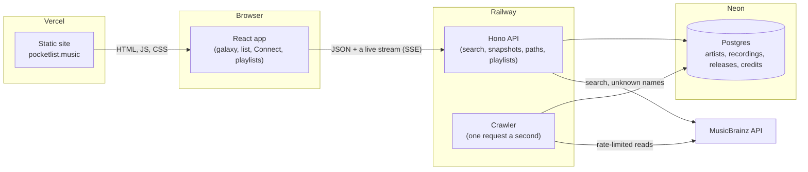

# How Pocketlist works

A guided tour of the whole app: what runs where, how the data gets in, how the numbers are
counted, what each screen does, what's known to be wrong, and what it would take to go further.
The plan and the reasons behind each decision live in [DESIGN.md](DESIGN.md); this is the map of
what exists today (2026-11-07).

---

## 1. In one paragraph

You type a jazz musician's name. Pocketlist finds them in [MusicBrainz](https://musicbrainz.org)
(the open music encyclopedia), reads their recording credits track by track, and shows everyone
they recorded with: as a **galaxy** of stars around them, or as a **list**. Click anyone to travel
to them. On top of that sit two features built from the same data: **Connect**, a six-degrees
game played in the galaxy, and a **playlist sampler** that picks songs two or more players made
together. Everything is live at <https://pocketlist.music>.

## 2. The big picture



Three pieces, each on the host that suits it:

| Piece | Where | Why there |
|---|---|---|
| The web app | **Vercel** (static) | Free, fast, deploys on every push. It's just files. |
| The API and crawler | **Railway** (one always-on Node process) | The crawler runs for minutes or hours, and the page holds a live connection open. Vercel's functions time out; Railway doesn't. |
| The cache | **Neon** (hosted Postgres) | Everything read from MusicBrainz is kept, so each recording is only ever read once. |

Locally the same code runs with [PGlite](https://pglite.dev) (Postgres compiled to WebAssembly)
instead of Neon, so there's nothing to install: `npm run dev`.

## 3. Hosting, configuration and deploys

- **Domain:** `pocketlist.music`, registered at GoDaddy: an A record for the apex and a CNAME for
  `www` (which redirects to the apex). The original `pocketlist.damonwood.dev` redirects to it. A new
  front-end address also has to be added to the API's `ALLOWED_ORIGINS`. The API is on
  Railway's own domain, `pocketlist-production.up.railway.app`.
- **Deploys:** a push to `main` deploys both halves: Vercel rebuilds the site; Railway rebuilds
  the API (its GitHub trigger was connected on 2026-11-07). `railway up --detach` from the repo
  still works for a manual deploy.
- **Settings** (environment variables, never in the code):

| Variable | Where | What it does |
|---|---|---|
| `VITE_API_URL` | Vercel | The API's address, baked into the site at build time. Unset locally, where Vite proxies `/api`. |
| `DATABASE_URL` | Railway | Neon's connection string (with `sslmode=verify-full`). Unset locally, which means PGlite. |
| `ALLOWED_ORIGINS` | Railway | Which sites may call the API (CORS). Takes `*` within one label, so Vercel preview URLs work. |
| `POCKETLIST_WARM` | optional | Pre-reads a starter set of players in the background when the server starts. |

- **Node 22** is pinned (`engines`, `.nvmrc`). Railway's default Node crashed the server.
- **To do before 2026-12-01:** Railway is retiring `railway.json`; move it to their new config
  format (`railway config migrate`).

## 4. The data

### What MusicBrainz gives us

MusicBrainz models music as **artists**, **recordings** (one performance, captured once), and
**releases** (an album as issued: the 1959 LP, the 1997 CD, the 2013 box set), grouped into
**release groups** (the album in the abstract). Credits are **relationships**: "Paul Chambers
played double bass on this recording", sometimes with a date.

Coverage is uneven, which is a known issue across music metadata: content providers' data is
incomplete or wrong, and MusicBrainz inherits some of that. See §9.

### What we keep (`server/db.ts`)

| Table | Holds |
|---|---|
| `artists` | Players we've looked up: name, disambiguation ("US jazz bassist"), type, and `indexed_at`, set once we've listed all their recordings. |
| `recordings` | Title, first release date, and `credits_loaded`: whether we've read its full personnel yet. |
| `credits` | One row per person per role per recording: who, which instruments, the relationship type, and its date if MusicBrainz has one. The heart of the app. |
| `releases` | Album issues: title, date, status (official, bootleg…), and the release group's primary type (album, single) and secondary types (compilation, live). |
| `recording_releases` | Which recordings appear on which releases. |

Only **performer** credits count: instrument, vocal, performer and performing orchestra.
Engineers and producers are kept out. Words that MusicBrainz attaches to instruments but aren't
instruments ("guest", "solo", "additional") are dropped. Placeholder names like `[unknown]` are
not treated as people.

## 5. The crawler: how credits get in (`server/crawler.ts`, `server/mb.ts`, `server/ingest.ts`)

MusicBrainz allows about **one request a second** per client, with an identifying User-Agent.
Everything is shaped by that.

- **One queue for the whole process** (`mb.ts`): every request waits its turn, spaced 1.1 seconds
  apart, whichever player it's for. A server error (5xx) is retried with back-off; a dropped
  connection or a 30-second timeout is retried too, and the real cause is logged.
- **Per player, one step at a time:**
  1. First visit: one request lists every recording the player is credited on (with their
     aliases, so "Walter Kane" finds Wally Kane).
  2. Then, repeatedly: take their earliest unread recording, read it, and fetch **its best
     album whole** (official, an album rather than a compilation, earliest first). One album
     request brings every track's personnel, so a 10-track LP costs two requests, not ten.
- **Who goes first:** players someone is looking at right now, the most watched first, then the
  most recently wanted. A player nobody has looked at for 15 minutes stops being read.
- **When things go wrong:** a failing player gets two more tries with a pause (15, then 30
  seconds) before the page is told, in plain words, that reading stopped partway. Anything already
  read is kept, so the next visit carries on where it stopped.
- **Keeping up with MusicBrainz:** people add credits every day. A player's recording list is
  re-read on the first visit after 30 days, which picks up recordings they've been credited on
  since. "Re-read from MusicBrainz" on the player page does that now and also re-reads the
  personnel of every recording already stored for them (up to 300, one request each), which
  picks up people added to old songs. It's limited to once every ten minutes per player, and the
  galaxy stays on screen and updates in place while it runs.
- **Scale, for a feel:** Ron Carter has 3,701 recordings. At one request a second, a player like
  that takes an hour or two to read completely the first time, and is instant after that.
  The page shows results within seconds and fills in as albums arrive.
- **Helpers:** `server/warm.ts` pre-reads a starter set; `server/copy-to-postgres.ts` copied the
  local cache into Neon at launch, merging with anything already there.

## 6. The counting rules (`server/aggregate.ts`)

These decide every number on screen, so they're pure functions with tests.

- A **collaboration** is two people credited on the same **recording**, not merely the same
  album. A pianist who sat in on one tune isn't credited with the whole record.
- A **session** is where a recording happened: the credit's date if there is one; otherwise the
  album it first came out on; otherwise the recording itself.
- **Duplicates collapse:** the same tune in the same session counts once, whether it's a duplicate
  entry, an alternate take or a rehearsal. Titles are normalized first (case, accents,
  punctuation, "(take 2)", "(alternate take)", "(rehearsal)").
- Collaborators are sorted by **sessions**, then tracks, then name.
- **Years** come from session dates, or failing that from release dates (see §9 for why that's
  a problem).

## 7. The API (`server/index.ts`)

| Endpoint | Returns |
|---|---|
| `GET /api/health` | `{ ok: true }`, for Railway's health check. |
| `GET /api/search?q=&instrument=` | Candidates from MusicBrainz. Every word typed must appear in the name or an alias; the instrument boosts matches ("plays bass"). |
| `GET /api/players/:id` | Name and description. |
| `GET /api/players/:id/stream` | A **live stream** (Server-Sent Events): a snapshot of the collaborator list at most every 1.5 seconds while reading, then a final one. Also starts or resumes the crawl. |
| `GET /api/players/:id/with/:other` | The recordings two players share, deduplicated, earliest first. |
| `GET /api/path?from=&to=` | The **shortest known chain** between two players (for Connect's par): breadth-first search over "credited on the same recording", from both ends at once, up to 6 hops, with one shared recording per link. |
| `GET /api/playlist?seeds=&n=&mix=` | A **sampler playlist**: songs every seed is on (one to four seeds). |

**Shared types** (`contract/index.ts`): every response shape is defined once and imported by both
the server and the app, with guards that check anything arriving over the network. A wrong shape
fails loudly at the edge instead of quietly inside a component.

## 8. The app (`src/`)

### Getting around

Where you are lives in the URL (`src/lib/route.ts`), so every view can be shared, a reload keeps
your place, and Back walks back along your trail:

| URL | View |
|---|---|
| `/` | Home: the promise, search, and three ways in |
| `/?q=wally+kane&i=flute` | Search results ("Which one?") |
| `/?p=<id>&trail=<id>,<id>` | A player's galaxy, with the players you came through |
| `&v=list` | …as a list instead |
| `&goal=<id>` | …while playing Connect |
| `/?pl=<id>,<id>&n=10&mix=0` | A playlist |

### The screens

- **Home** (`App.tsx`): three cards (explore a galaxy, play Connect, make a playlist) whose buttons
  open players already read, so the first click is instant.
- **Player** (`PlayerView.tsx`): name, description, actions (Playlist, Connect from here), a
  one-line summary, then the galaxy or list. The list rows expand to the shared recordings.
- **The galaxy** (`Galaxy.tsx`, layout in `src/lib/galaxy.ts`):
  - **Distance** = sessions together (log scale; closer is more).
  - **Angle** = the year they first recorded together, clockwise from the top. Busy years get more
    of the circle, so a crowded decade spreads out; the decade marks follow the same scale.
  - **Colour** = heat: sessions per year of the partnership. Blue is long and steady, orange is a
    burst, grey is too few sessions to say. **Size** = shared tracks.
  - Drawn on a **canvas** (a thousand-plus stars stay smooth), with no physics: positions are
    computed, so the same data always draws the same galaxy.
  - **Travel:** click a star and it slides to the centre while shared collaborators move to their
    new places. The page keeps its scroll position through it.
  - While a player is still being read, stars already placed **stay put** (so you can click them),
    and everything settles once reading finishes.
  - **Guidance:** a one-time hint (touch and pointer versions), the key on the canvas, a
    "still reading" chip. On desktop a tooltip follows the pointer (click to go, shift-click for a
    playlist together); on touch, tap selects and the card below has the buttons.
  - **Accessible route:** arrow keys step through stars closest first, Enter travels, +/- zoom;
    the list view is the screen-reader view of the same data.
- **Connect** (`Connect.tsx`): a puzzle of the day, or "Connect from here" to pick any goal. The
  goal glows wherever it appears; the banner shows hops against **par** (the shortest known
  chain). Arriving shows the chain, the record behind each link, and a **Copy result** for sharing.
- **Two kinds of playlist**, each with its own mark (`src/components/marks.ts`) on every way in:
  a **Sampler** (record icon, amber) is songs a player or players made together: exploring. A
  **Journey** (Connect's route icon, rose) travels from one player to another, hand to hand: a
  Connect path you can listen to, drawn as a route map with a stop at each player. Ways in: the
  player page (Sampler), shift-click in the galaxy (a sampler of the two of you), the breadcrumb
  trail (Journey playlist) and the Connect result (Listen to this journey).
- **Samplers** (`PlaylistView.tsx`, rules in `server/playlist.ts`): songs every seed played on,
  one per session, spread across the years, no tune twice, finished versions before takes. 10, 20
  or 30 songs, "Another mix", and text or CSV downloads that say who played what. Each song
  shows its album and **album artist** ("Seven Steps… by Miles Davis"), so a tune that's on
  several records can be told apart. Album artists are stored as releases are read; for releases
  read before that, MusicBrainz's search fills in up to 50 at a time when a list needs them, and
  nobody waits more than about three seconds: the rest carries on in the background. The shared
  recordings under each collaborator show it too, and pick their album the same way.
- **Finding the songs on a streaming service.** In jazz the same tune is recorded again and again,
  and reissues get new names, so a title search is a guess. The best clue is **length**: a
  re-recording or a live version is usually off by much more than a renamed reissue of the same
  recording, which (through mastering, edits or an earlier fade) can still differ by a second or
  more. Hence a tolerance, not an exact match. So each song shows its **credited artist** (as services label it) and
  **length**, and:
  - **Apple Music ✓** links go straight to the song (`server/apple.ts`): Apple's free search API
    for title and artist, keeping only same-title results within 3 seconds (or 1.5%) of the
    MusicBrainz length. No length, no match. Apple allows ~20 searches a minute, so lookups go
    through one slow queue and every answer is stored in `apple_matches`; the page asks again
    while some are pending. Song pages have "Add to Playlist" in the ⋯ menu; search pages don't.
  - Spotify and YouTube Music get a search for title, artist and album (length tells you which).
  - **Copy for TuneMyMusic** copies "Artist - Title" lines, which TuneMyMusic or Soundiiz turn into
    a playlist on any service in one paste.
  - **Swap** (↻ on each song, `/api/swap`) replaces one song with another by the same players
    (the same step, on a path), never a tune already in the list. Swaps live on the page only;
    they aren't in the URL.
- **Add a player** (up to four, `/api/also-on`): a sampler suggests who else is on the most of its
  performances, counted the way the sampler counts them, with the number on each chip. Suggestions
  come from the list itself, so adding one never empties it, and you can see how far it narrows.
  Adding players one at a time is how you find a band: Carter + Hancock suggests Tony Williams,
  then Miles Davis and Wayne Shorter.
- **Notes about this feature**, a closed-by-default note on both playlist pages: why finding these
  songs on a streaming service is hard (standards, reissues, renamed compilations) and how length helps.
- **Journeys** (`?pp=`): the same rules for each step of a breadcrumb trail, and no tune
  twice across the whole list. A player in the middle of a path is in two pairs, so without that
  the same song turns up in neighbouring steps; a repeat is allowed only if a step would
  otherwise be empty.

### Look and feel

Design tokens in `src/index.css` (a paper-and-brass light theme, ink-and-brass dark, both checked
for contrast), seeded from the system setting with no flash of the wrong theme. Components are
shadcn-style (`src/components/ui/`), owned in the repo. Fraunces for headings, Inter for text.

## 9. Known issues and limits

- **Years from reissues.** A session only known from a later reissue takes the reissue's year:
  Wynton Kelly (died 1971) shows "1956–2013, long and steady" with Paul Chambers. The ℗ line
  doesn't fix it (often missing, usually dating the reissue). Plan in DESIGN.md: treat release
  dates as an upper bound, cap with death years, compute heat from dated sessions only.
- **Coverage.** Credits are only as complete as MusicBrainz. Some albums have full personnel,
  some only the leader.
- **Cold starts.** A player nobody has visited takes minutes to hours to read in full; results
  appear early, but Connect hops through unread players feel slow.
- **One crawler.** The crawler lives inside the API process. A restart drops the in-memory queue
  (nothing read is lost, and the next visit resumes), and it can't run on more than one machine.
- **Par is "best known".** It only sees what's been read, so it can shorten as more is read.
- **Canvas accessibility.** Screen readers can't see into the galaxy; the list is the accessible
  view, and the keyboard can drive the galaxy.
- **No accounts.** Nothing is saved per person; there's nothing to protect yet.

## 10. Tests

`npm test` runs 21 unit tests:

- `server/aggregate.test.ts`: the counting rules.
- `server/playlist.test.ts`: the playlist rules.
- `src/lib/galaxy.test.ts`: heat, distance and the clockwise layout.

There are no end-to-end tests yet (see §11).

## 11. Taking it further: the tech it would need

Roughly in the order they'd pay off.

**Data: more of it, faster, and more right**
- **Read the source in bulk, not one request a second.** MusicBrainz publishes full database
  dumps and a replication feed; a mirror (their `musicbrainz-docker` setup) removes the rate limit
  entirely and makes cold starts disappear. Cost: a database of tens of gigabytes and a small
  server, instead of the free tier.
- **Until then, pre-read in the background:** a few dozen key players a day, well inside the
  limit, so Connect hops are instant more often.
- **Dates done properly** (the §9 fix): ingest artists' life spans; keep dated and undated
  sessions apart; show uncertainty.
- **A second source:** Discogs (API and dumps) has strong jazz personnel. It needs **entity
  resolution**: matching the same person and the same recording across both sources, which is the
  hard part of all music metadata.
- **Corrections from users:** a local overrides table first; later accounts (for example Neon
  Auth) and moderation; or simply a "fix this on MusicBrainz" link, which improves the source for
  everyone.

**Back end: sturdier and quicker**
- **A durable job queue** on the same Postgres (pg-boss or Graphile Worker), so the crawler
  survives restarts and can run as a separate worker, or several.
- **A precomputed co-credit graph:** one table of player pairs with session counts, refreshed as
  credits arrive. Connect's pathfinding and every galaxy query get much cheaper.
- **Caching** finished galaxies and paths at the edge (ETags, a CDN), since they rarely change.
- **Local search** with Postgres trigram matching, so names already read don't need MusicBrainz.

**Listening: from credits to music**
- **ISRCs** (the recording codes MusicBrainz often has) map to Spotify and Apple Music tracks. That
  gives "listen" links, and, with Spotify sign-in (OAuth), exporting a playlist straight to an
  account. Needs a Spotify developer app and careful rate handling.

**AI: doing things in the app, not a chatbot on the side**
- A server-side model connector (swappable provider, key never in the browser) with **tool use**
  over Pocketlist's own API: "Make me a playlist of Coltrane's quartet ballads" becomes a search,
  a filter and a playlist; "Why are these two connected?" becomes a short explanation built from
  the shared sessions.
- **Name disambiguation:** picking the right "Bill Evans" from context.
- **An MCP server** exposing search, path and playlist as tools, so agents can operate the app.

**Front end at scale**
- **WebGL** (for example PixiJS or regl) once galaxies pass about 5,000 stars, and layout in a
  Web Worker.
- **End-to-end tests** (Playwright) with an automated accessibility check (axe), and a
  screenshot row in the README for desktop, tablet and phone.

**Running it**
- Error tracking (for example Sentry), uptime checks, and a small dashboard of crawl progress and
  MusicBrainz request rates.

## 12. Where things live

```
contract/index.ts        shared types and guards (server and app)
server/index.ts          the API: routes, search, snapshots, path, playlist, CORS
server/crawler.ts        who to read next, and reading them
server/mb.ts             the MusicBrainz client: one queue, retries
server/ingest.ts         turning MusicBrainz JSON into rows
server/db.ts             Postgres (Neon) or PGlite, and the schema
server/aggregate.ts      the counting rules            (+ aggregate.test.ts)
server/playlist.ts       the playlist rules            (+ playlist.test.ts)
server/warm.ts           pre-read a starter set
server/copy-to-postgres.ts  local cache to Neon
src/App.tsx              header, home page, routing
src/lib/route.ts         the URL is the state
src/lib/api.ts           the app's only door to the API
src/lib/galaxy.ts        where every star goes         (+ galaxy.test.ts)
src/components/          Galaxy, PlayerView, Connect, PlaylistView, Search, Mark, ui/
docs/DESIGN.md           the plan, decisions, milestones, open questions
railway.json, .nvmrc     deploy settings
```
